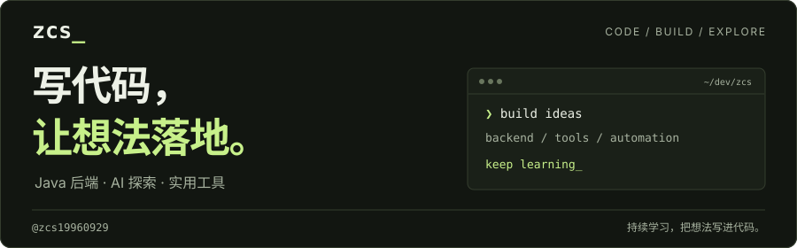
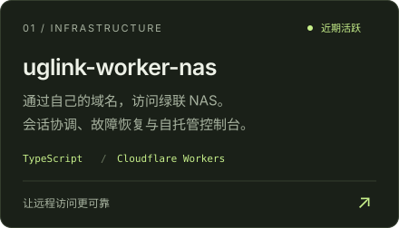
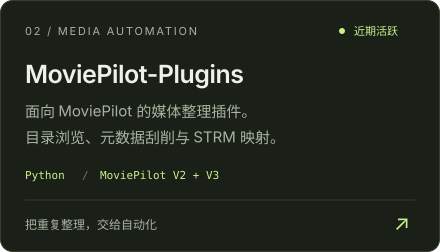

<p align="center">
  <picture>
    <source media="(max-width: 600px)" srcset="assets/profile-banner-mobile.svg" />
    
  </picture>
</p>

<p align="center">
  <a href="#projects--experiments">Projects</a> &nbsp; · &nbsp;
  <a href="#tech-stack">Tech Stack</a> &nbsp; · &nbsp;
  <a href="https://github.com/zcs19960929?tab=repositories">All Repositories ↗</a>
</p>

## About Me

```java
import java.util.List;

public final class Zcs19960929 {
    private final String role = "Java Backend Developer";
    private final List<String> interests = List.of(
        "Backend Architecture",
        "AI-assisted Engineering",
        "Open Source"
    );

    public String currentlyExploring() {
        return "Reliable services, developer tools, and practical AI applications";
    }
}
```

- ☕ I build maintainable backend services in the Java ecosystem.
- 🤖 I explore how AI can improve engineering workflows and real-world products.
- 🧩 I enjoy learning in public through open-source projects and experiments.

## Tech Stack

<p>
  
  
  
  
  
  
  
  
  
  
  
</p>

## Projects & Experiments

近期聚焦 **NAS 代理可靠性** 与 **媒体整理自动化**。

<p align="center">
  <a href="https://github.com/zcs19960929/uglink-worker-nas"></a>
  <a href="https://github.com/zcs19960929/MoviePilot-Plugins"></a>
</p>

<p align="center">
  <sub>根据 2026.10.14–10.21 的公开提交更新 · <a href="https://github.com/zcs19960929?tab=repositories">探索更多项目 ↗</a></sub>
</p>

## GitHub Analytics

<div align="center">
  <a href="https://github.com/zcs19960929">
    
  </a>
  <a href="https://github.com/zcs19960929">
    
  </a>
</div>

<div align="center">
  <a href="https://github.com/zcs19960929">
    
  </a>
</div>

---

<div align="center">
  Thanks for stopping by — feel free to explore the repositories and connect through open source.
</div>

